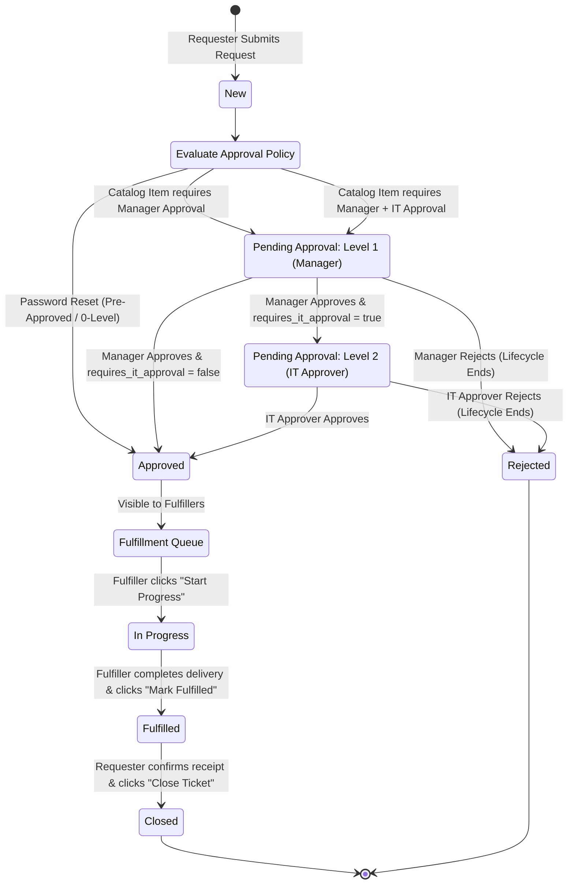

# ITSM Service Request Management Process Guide

## 1. Overview & Objectives

The **ServiceFlow ITSM Service Request Management System** implements industry-standard Information Technology Service Management (ITSM) workflows aligned with ITIL v4 best practices. Its primary objective is to provide a standardized, transparent, and auditable pathway for employees to request standard services, software, hardware, and access privileges while enforcing organizational governance, cybersecurity compliance, and Service Level Agreements (SLAs).

---

## 2. Request Lifecycle & State Machine

Every service request transitions through defined statuses from intake to formal closure. State changes are strictly enforced by the backend workflow engine, and every state mutation is recorded in the immutable audit trail (`request_history`).

### Request Statuses
- **`New`**: Ticket received and assigned initial SLA target.
- **`Pending Approval`**: Ticket awaiting management endorsement (Level 1) or IT Security/Architecture review (Level 2).
- **`Approved`**: All required approval gates cleared. Ticket is queued for fulfillment.
- **`In Progress`**: An IT fulfillment engineer has claimed the work order and is actively provisioning the service.
- **`Fulfilled`**: Technical delivery completed (software provisioned, hardware configured, or access granted). Resolution timestamp recorded.
- **`Closed`**: The requester verifies delivery and formally closes the ticket.
- **`Rejected`**: An approver denies the request with mandatory business justification. The lifecycle terminates immediately.

### Workflow State Diagram

---

## 3. Service Catalog & Approval Tiers

The service catalog categorizes offerings into distinct approval tiers based on security impact, capital expense, and compliance risk.

| Catalog Offering | Category | Approval Tier | Reviewers | Rationale |
| :--- | :--- | :--- | :--- | :--- |
| **Password Reset** | Identity & Access | **Tier 0: Pre-Approved** | None (Automated) | Low-risk standard operational request. Auto-approved immediately upon submission to minimize downtime. |
| **VPN Access** | Security & Access | **Tier 1: Single-Level** | Manager (Level 1) | Requires managerial verification of remote work business need. |
| **New User Onboarding** | Human Resources | **Tier 1: Single-Level** | Manager (Level 1) | Requires department manager sign-off for seat, accounts, and department resources. |
| **Laptop Request** | Hardware | **Tier 2: Multi-Level** | 1. Manager 2. IT Approver | Level 1 ensures departmental budget allocation; Level 2 verifies hardware fleet standards and stock availability. |
| **Software Access** | Software | **Tier 2: Multi-Level** | 1. Manager 2. IT Approver | Level 1 ensures departmental budget coverage; Level 2 verifies license pool availability and cybersecurity compliance. |

---

## 4. Roles & Responsibilities (RACI Matrix)

The system defines four discrete operational roles to guarantee segregation of duties:

| Role | Responsibility Description | Default Persona |
| :--- | :--- | :--- |
| **Requester** | Employees who browse the catalog, submit requests, monitor progress, and close fulfilled tickets. | Alice Johnson, Evan Wright |
| **Manager** | Departmental supervisors responsible for Level 1 budgetary and operational approval. | Bob Smith |
| **IT Approver** | IT Security officers or System Architects responsible for Level 2 compliance and technical validation. | Charlie Davis |
| **Fulfiller** | IT Helpdesk engineers and system administrators who provision hardware, software, and services. | Diana Prince |

### RACI Matrix

| ITSM Lifecycle Phase | Requester | Manager | IT Approver | Fulfiller |
| :--- | :---: | :---: | :---: | :---: |
| Catalog Selection & Submission | **R** | I | I | I |
| Level 1 Approval (Budget/Need) | I | **A / R** | I | I |
| Level 2 Approval (Security/Standards) | I | I | **A / R** | I |
| Claiming Workorder (In Progress) | I | I | I | **R** |
| Service Delivery & Fulfillment | I | I | I | **A / R** |
| Ticket Verification & Final Closure | **A / R** | I | I | I |

*Key: **R** = Responsible, **A** = Accountable, **C** = Consulted, **I** = Informed.*

---

## 5. Service Level Agreement (SLA) Definitions & Policies

SLAs establish formal operational commitments between IT Operations and organizational stakeholders.

### SLA Windows by Priority

| Priority Tier | Target SLA Duration | Clock Trigger | Clock Stop | Criteria / Impact |
| :--- | :---: | :--- | :--- | :--- |
| **High** | **4 Hours** | Ticket Submission (`created_at`) | Technical Fulfillment (`resolved_at`) | Critical work stoppage or security lockout. |
| **Medium** | **24 Hours (1 Day)** | Ticket Submission (`created_at`) | Technical Fulfillment (`resolved_at`) | Standard business operations requests (e.g. software licenses). |
| **Low** | **72 Hours (3 Days)** | Ticket Submission (`created_at`) | Technical Fulfillment (`resolved_at`) | Routine hardware upgrades or future-dated onboarding. |

### Formula & Due Date Calculation
$$\text{due\_at} = \text{created\_at} + \text{SLA\_Duration}(\text{Priority})$$

### Breach Detection & Live Health Statuses
1. **Healthy (Green)**: $\text{Time Remaining} > 20\%$ of total SLA duration.
2. **At Risk (Amber)**: $\text{Time Remaining} \le 20\%$ of total SLA duration. Prominently highlights in the UI with a pulsing amber beacon to trigger rapid escalations.
3. **Breached (Red)**: $\text{Current Time} > \text{due\_at}$ for open tickets, or $\text{resolved\_at} > \text{due\_at}$ for fulfilled tickets.
4. **Met SLA (Emerald)**: $\text{resolved\_at} \le \text{due\_at}$.

Breach inspections run on every API read operation and asynchronously every 60 seconds via a background server daemon.

---

## 6. Key Performance Indicator (KPI) Definitions

The executive dashboard computes four operational ITSM widgets:

### 1. Request Volume Trends
- **Daily Intake Velocity**: Daily count of new requests logged over time.
- **Service Distribution**: Total requests grouped by Service Catalog item.

### 2. Active Backlog Distribution
- **Definition**: Active open requests pending resolution ($\text{status} \in \{\text{'Pending Approval'}, \text{'Approved'}, \text{'In Progress'}\}$).
- **Target**: Maintain minimal backlog aging and prevent accumulation in approval queues.

### 3. SLA Compliance Percentage
- **Overall Compliance Rate**:
$$\text{SLA Compliance \%} = \left(\frac{\text{Total Requests Met}}{\text{Total Requests}}\right) \times 100$$
- **Priority Tier Breakdown**: Independent compliance percentages for High, Medium, and Low tickets.
- **Industry Benchmark**: Target $\ge 90\%$ compliance.

### 4. Mean Time to Fulfill (MTTF) / Average Resolution Time
- **Definition**: The arithmetic mean of resolution elapsed time in hours for all resolved tickets:
$$\text{MTTF}_{\text{catalog}} = \frac{1}{N} \sum_{i=1}^{N} \left(\frac{\text{resolved\_at}_i - \text{created\_at}_i}{3600}\right)$$
- **Application**: Identifies operational bottlenecks across hardware versus software fulfillment streams.
